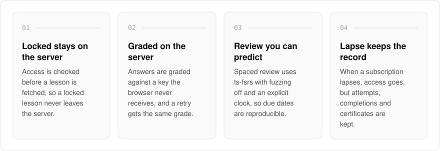
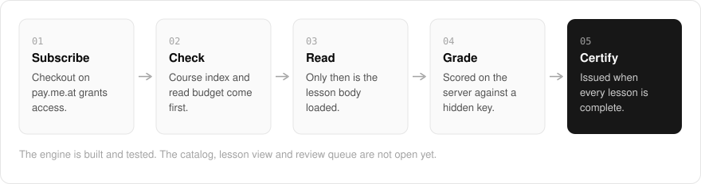

  <picture>
    <source media="(prefers-color-scheme: dark)" srcset=".github/assets/hero-dark.png">
    
  </picture>

<h1 align="center">study.me.at</h1>

<strong>My working notes, behind a paywall that holds.</strong>

  
  
  
  

  <a href="#features">Features</a> ·
  <a href="#how-it-works">How it works</a> ·
  <a href="#screenshots">Screenshots</a> ·
  <a href="#built-with">Built with</a>

On a lot of paid sites, the paywall is a curtain drawn over a page the browser already has. I built study.me.at so access is checked before anything is fetched: a locked note never leaves the server, and a quiz answer key never reaches the browser. I am using it to publish my own notebook behind one subscription: how I run the me.at apps and what they cost, long notes on the libraries I use every day, product research, and my decision records and runbooks. Underneath is a full learning engine with server-graded quizzes, spaced review and certificates, and the content always stays the operator's.

> **Status:** which notes go in, and where each preview ends, is not settled yet. Today a visitor can see the plans and go through checkout on pay.me.at. The engine underneath is written and tested, but there is no catalog, lesson view or review queue yet.

  <picture>
    <source media="(prefers-color-scheme: dark)" srcset=".github/assets/overview-dark.svg">
    
  </picture>

## Why study.me.at

| The usual paywall | study.me.at |
| --- | --- |
| Sends the page, then hides it | Checks access before the page body is loaded |
| Ships the answer key with the quiz | Grades on the server against a key the browser never sees |
| A lapsed subscription takes your progress with it | Access ends, but attempts, completions, certificates and review cards stay |
| Proctoring and screen monitoring | Surveillance features sit on a refused list kept closed by tests |

## Features

- **Check access, then fetch**: a read checks the course index and the reader's gated-read budget before the lesson body is loaded.
- **Gated unless marked free**: lessons are private by default, and a locked lesson shows a teaser and a paywall instead of a 404.
- **Server-side grading**: answers are graded against a key the browser never receives, and retried submissions get the same grade.
- **Predictable spaced review**: scheduling uses ts-fsrs with fuzzing off and an explicit clock, so due dates are reproducible.
- **Lapse keeps the record**: when a subscription lapses, access goes but attempts, completions, certificates and review cards are kept.
- **Certificates that outlast the subscription**: issued only when every lesson is complete, tied to the course version, and verifiable without a login.
- **Operator analytics without learner ids**: enrollment, a per-module completion funnel and per-question difficulty.
- **Surveillance refused in code**: proctoring, screen monitoring, device fingerprinting and watermarking are on a refused list kept closed by tests.

## How it works

  <picture>
    <source media="(prefers-color-scheme: dark)" srcset=".github/assets/flow-dark.svg">
    
  </picture>

Checkout runs on pay.me.at, and the entitlement it grants is what every read is checked against. A read checks the course index and the reader's gated-read budget first, and only then loads the lesson body. Quiz answers are scored on the server, and a certificate is issued once every lesson in that course version is complete.

## Screenshots

<table>
  <tr>
    <td width="50%"><picture><source media="(prefers-color-scheme: dark)" srcset=".github/assets/hero-dark.png"></picture> The landing page: the shelves of the notebook and what a subscription opens.</td>
    <td width="50%"><picture><source media="(prefers-color-scheme: dark)" srcset=".github/assets/pricing-dark.png"></picture> Pricing: free previews, one subscription for the rest, and a self-hosted licence.</td>
  </tr>
</table>

## Built with

  
  
  
  
  
  

- Next.js 16 (App Router), React 19, TypeScript
- Tailwind CSS 4
- ts-fsrs for spaced review scheduling
- Drizzle ORM + Postgres
- Better Auth
- oRPC + TanStack Query
- Checkout and entitlements through pay.me.at

## Part of the me.at family

study.me.at is one of my [`*.me.at`](https://me.at) apps. They share one design system, account, and app shell. Development happens in a private monorepo; this repository is the project's public-facing home.

## License

Source-available. See [LICENSE](LICENSE).
