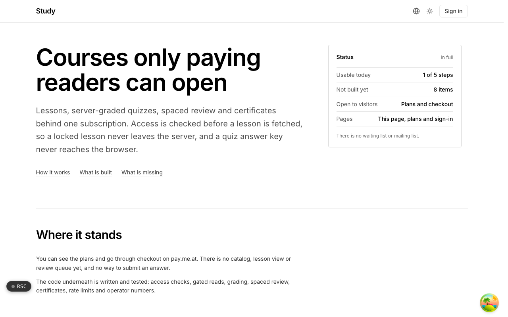
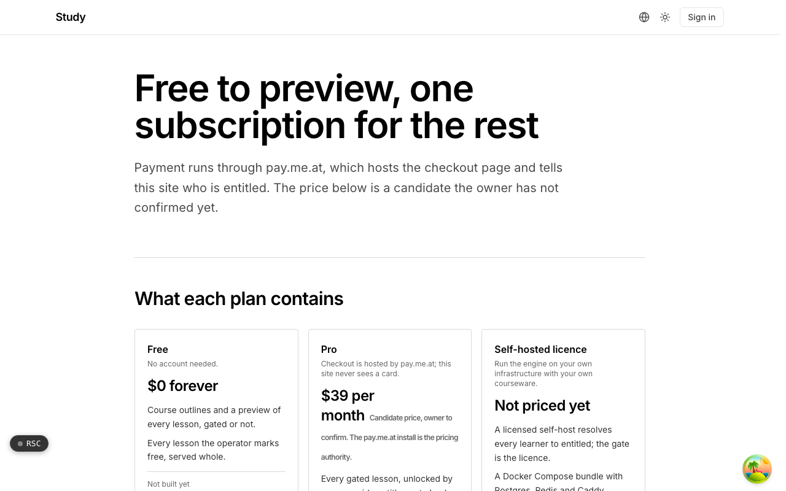

  <picture>
    <source media="(prefers-color-scheme: dark)" srcset=".github/assets/hero-dark.png">
    
  </picture>

# study.me.at

Courses only paying readers can open.

study.me.at is subscription-gated learning modules: written lessons, server-graded quizzes, spaced review and certificates behind one subscription. Access is checked before a lesson is fetched, so a locked lesson never leaves the server and a quiz answer key never reaches the browser, and the courseware stays the operator's. Today a visitor can see the plans and go through checkout on pay.me.at; the engine underneath is written and tested, but there is no catalog, lesson view or review queue yet.

## Features

- **Check access, then fetch**: a read checks the course index and the reader's gated-read budget before the lesson body is loaded.
- **Gated unless marked free**: lessons are private by default, and a locked lesson shows a teaser and a paywall instead of a 404.
- **Server-side grading**: answers are graded against a key the browser never receives, and retried submissions get the same grade.
- **Predictable spaced review**: scheduling uses ts-fsrs with fuzzing off and an explicit clock, so due dates are reproducible.
- **Lapse keeps the record**: when a subscription lapses, access goes but attempts, completions, certificates and review cards are kept.
- **Certificates that outlast the subscription**: issued only when every lesson is complete, tied to the course version, and verifiable without a login.
- **Operator analytics without learner ids**: enrollment, a per-module completion funnel and per-question difficulty.
- **Surveillance refused in code**: proctoring, screen monitoring, device fingerprinting and watermarking are on a refused list kept closed by tests.

## Screenshots

<table>
  <tr>
    <td width="50%"><picture><source media="(prefers-color-scheme: dark)" srcset=".github/assets/pricing-dark.png"></picture> Pricing: free previews, one subscription for the rest, and a self-hosted licence</td>
  </tr>
</table>

## Built with

- Next.js 16 (App Router), React 19, TypeScript
- Tailwind CSS 4
- ts-fsrs for spaced review scheduling
- Drizzle ORM + Postgres
- Better Auth
- oRPC + TanStack Query
- Checkout and entitlements through pay.me.at

## Part of the me.at family

study.me.at is one of my [`*.me.at`](https://me.at) apps. They share one design system, account, and app shell. Development happens in a private monorepo; this repository is the project's public-facing home.

## License

See [LICENSE](LICENSE).
